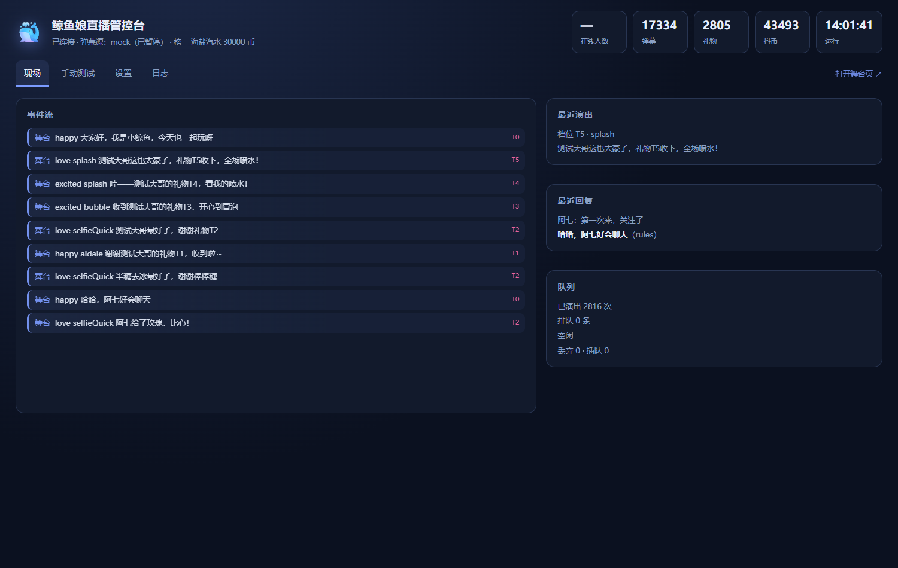

# 鲸鱼娘直播 · 抖音虚拟形象插件

一个跑在你自己电脑上的直播插件：**鲸鱼娘 Live2D 形象上播，实时读直播间弹幕，
按打赏档位做出越来越夸张的反应**——从点头致谢到喷水撒花。

OBS 用「浏览器源」把它叠进画面，背景透明。


---

## 文档索引

| 文档 | 讲什么 |
| --- | --- |
| [docs/图文教程.md](docs/图文教程.md) / [.docx](docs/图文教程.docx) | **给外人的完整介绍**：为什么做、怎么跑起来、设计上的取舍、踩过的坑 |
| [docs/创作说明.md](docs/创作说明.md) / [.docx](docs/创作说明.docx) | 选题动机、需求分析、AI 工具与踩坑（投稿用） |
| [docs/开播测试流程.md](docs/开播测试流程.md) | **第一次上播照着做**：开播拿房间号 → OBS → 直播伴侣 → 接弹幕 → 测游戏 |
| [docs/项目文档.md](docs/项目文档.md) | 整体设计、模块拆分、验收方式 |
| [docs/设计-语音与点歌.md](docs/设计-语音与点歌.md) | 语音链路与点歌（点歌当前停用） |
| [docs/抖音弹幕接入.md](docs/抖音弹幕接入.md) | 抓取原理、真机实测记录、踩过的坑 |
| [docs/OBS接入.md](docs/OBS接入.md) | 浏览器源参数、透明、尺寸 |

五档打赏演出的对照图：[T1](docs/screenshots/stage-gift-t1.png) · [T2](docs/screenshots/stage-gift-t2.png) · [T3](docs/screenshots/stage-gift-t3.png) · [T4](docs/screenshots/stage-gift-t4.png) · [T5](docs/screenshots/stage-gift-t5.png)　管控台：[admin.png](docs/screenshots/admin.png)

---

## 它是什么 / 不是什么

| 是 | 不是 |
| --- | --- |
| 一个透明的 OBS 图层，形象会动、会说话（气泡）、会做动作 | 不是一个"AI 全托管主播"——默认不接大模型，不花钱 |
| 一个把「打赏金额」映射成「演出强度」的引擎 | 不是刷量 / 小号 / 对抗风控的工具 |
| 一个可以换形象、换平台、换大脑的骨架 | 不是开箱即用的商业产品，需要你自己接直播间 |
| 全部跑在本机，除可选的大模型外不出网 | 不是云端服务，没有多机部署 |

**核心思路**：金额是硬通货，礼物名不是。所以分档看 `diamondCount`，而不是维护一张礼物价目表。

---

## 三步跑起来

```powershell
# 1. 装依赖
npm install --ignore-scripts

# 2. 起服务
node src/index.mjs

# 3. 打开这两个地址
#    舞台（OBS 用这个）：http://127.0.0.1:8787/avatar
#    管控台：            http://127.0.0.1:8787/admin/
```

第一次启动会自动生成 `config/config.json`，并默认跑**模拟直播间**——
不用登录、不用开播，几十秒内就能看到弹幕滚进来、鲸鱼娘回话、礼物触发动作。

需要 Node ≥ 20.11。`--ignore-scripts` 只是给受限环境用的，普通机器不加也行。

确认没问题后，按 [docs/抖音弹幕接入.md](docs/抖音弹幕接入.md) 换成真实直播间。

---

## 两个界面

### 舞台 `/avatar`（给 OBS）

- 透明背景，1920×1080 直接铺满
- 左下角弹幕流水（`?feed=0` 关掉）
- 她说话时头顶出气泡，嘴会动
- 大额打赏左上角出横幅，同时有喷水 / 撒花 / 爱心 / 烟花

尺寸位置用 URL 参数调：`?h=900&corner=br&feed=0`。详见 [docs/OBS接入.md](docs/OBS接入.md)。

透明底是实测过的：`html/body` 背景 `rgba(0,0,0,0)`，画布 `backgroundAlpha: 0`，
截图四个角像素 `A=0`（`docs/screenshots/stage-alpha.png` 就是带透明通道的原图）。


### 管控台 `/admin/`

| 标签 | 干什么 |
| --- | --- |
| 现场 | 实时事件流、最近一次演出/回复、队列、在线人数、抖币总额 |
| 手动测试 | 一键触发五档打赏、让她说一句、单独播动作/特效、暂停/继续收弹幕 |
| 设置 | 互动频率、演出节奏、大脑模式（热改，不用重启） |
| 日志 | 最近 300 条运行日志 |



---

## 打赏 → 行为

金额单位是**抖币**，按礼物消息里的 `diamondCount` 自动分档。

| 档 | 门槛 | 动作 | 表情 | 特效 | 台词（示例） |
| --- | --- | --- | --- | --- | --- |
| T1 小心意 | 0–1 | 歪头点头 | 开心 | 小爱心 | 「谢谢{name}的{gift}，收到啦～」 |
| T2 有份量 | 2–9 | 快速自拍 | 爱心眼 | 爱心加倍 | 「{name}给了{gift}，比心！」 |
| T3 挺大方 | 10–99 | **吹泡泡** | 星星眼 | 泡泡 + 星星 | 「{name}的{gift}到啦，给你吹个泡泡」 |
| T4 大礼 | 100–2999 | **喷水** + 鲸鱼帽 | 兴奋 | 喷水 + 撒花 | 「哇——{name}的{gift}，看我的喷水！」 |
| T5 重礼 | 3000+ | **喷水** + 鲸鱼帽 + 蝴蝶结 | 爱心眼 | 烟花 + 撒花 + 爱心 | 「{name}的{gift}！今天最亮的鲸鱼是给你喷水的」 |

规则细节：

- **连击合并**：同一礼物连刷按累计金额算档位，途中在 3 / 10 / 52 / 1314 连额外播报一句，
  结束（`repeatEnd`）再完整演一次。所以「刷 200 个小心心」也会升档——不然小礼物永远没反馈。
- **演出占线**：演出那几秒不接受闲聊插话。3 万抖币的气泡不会被一句「主播好可爱」顶掉。
- **关注**：点头 + 星星。**点赞 / 进场**：只更新数字，不打扰画面。

改 `src/reaction/behavior.mjs` 那一张表就能改整个性格。

---

## 猜词小游戏：怎么玩

送 T4 以上的礼物自动开一局（测试时把 `games.minTier` 调成 1 就行）。

### 先看一眼流程

| 画面 | 说明 |
| --- | --- |
|  | **待机**：左下常驻说明，告诉新观众怎么触发、怎么参与 |
|  | **开场 3.5 秒**：词板翻面 + 高亮，写明是谁解锁的、几个字、共几轮 |
|  | **选题**：三个候选问题，观众发 1/2/3 挑一个 |
|  | **回答**：四个选项，发 1-4 投票，票数实时涨 |
|  | **揭晓**：翻牌公布答案，票数和猜对的人一起出现 |

### 两种模式

| | 反向（默认） | 正向 |
| --- | --- | --- |
| 谁知道答案 | **观众** | 系统 |
| 她做什么 | 提问、猜 | 描述提示 |
| 观众做什么 | 选题 + 投票 | 猜 A/B/C/D |
| 词板 | 正面朝观众（她看不到） | 背面写 `?` |
| 切换 | `"games": { "mode": "reverse" }` | `"games": { "mode": "forward" }` |

### 她真的在猜

每轮结束会调一次大模型，让它看当前线索，从两个动作里选一个：

```json
{ "action": "ask" }
{ "action": "guess", "guess": "鲸鱼", "reason": "海边 + 冰冰凉" }
```

- **猜对**：立刻揭晓，提前结束
- **猜错**：她说「我猜是 XX……不对啊」，继续问
- **到最大轮数**：强制猜，不许再问
- **模型挂了/超时**：当作继续问，游戏不会卡住

---

## 猜词小游戏（礼物触发）

送 **T4 以上**的礼物自动开一局，默认是**反向猜词**——观众藏着答案，她来问。

```
第 1..5 轮：
  [选题 10s]  屏幕给三个候选问题，观众发 1/2/3 选一个
  [提问 4s]   她把选中的问题问出来
  [回答 15s]  观众发 1/2/3/4 选一个联想选项（0 = 不确定）
      ↓
[揭晓 8s]    系统公布答案，她演一句「原来是这个」
```

**词板朝向**：

| 模式 | 词板显示 | 谁看得见 |
| --- | --- | --- |
| 正向（她描述、观众猜） | 背面写 `?` | 谁都不知道 |
| 反向（观众藏词、她问） | **正面显示答案** | 只有观众——她收到的只有「问题」和「票数」，从没有这个词 |

反向模式里那个字段叫 `displayWord`，专门给舞台画图用，**不会进入任何模型调用**；
管控台和 `/api/state` 在揭晓前也拿不到答案。

两个直播间的老问题，靠机制解决而不是靠 prompt：

| 问题 | 解法 |
| --- | --- |
| 观众把答案打在公屏上 | 合法回答只有 `1..4`，其他内容**不计票也不上屏** |
| 观众回答不一致 | 投票取**相对多数**；平票才算「说不清」，她会说「你们说法都不一样」 |
| 一个人刷票 | 每人每阶段一票，改票无效 |
| 游戏被闲聊打断 | 游戏期间闲聊/点歌全部让路 |

想换回「她描述、观众猜」的正面模式：`games.mode` 改成 `forward`（代码都在）。

**内置内容**：

| 内容 | 数量 | 位置 |
| --- | --- | --- |
| 词库 | 45 个词，8 个类别（水果/食物/动物/家电/物品/家具/交通/自然） | `src/games/words.mjs` |
| 题库 | **18 道联想题**（每题 4 个选项） | `src/games/questions.mjs` |
| 选项 | 每题自带 4 个联想选项，另加 `0` 弃权 | 同上 |

**题目问的是「联想」不是「事实」**：不是「它比人高吗」，而是「如果它是动物，会是哪种」。
事实题答案唯一、两轮就把答案锁死；联想题答案主观，分歧本身就是内容。
加词只需一行 `{ word, category, hint }`，干扰项按「同类别+同字数+首字不同」自动生成。

---

## 她会说话，也会唱歌

> 抖音抓取已于 2026-10-30 用真实直播间跑通（64 帧 / 171 事件 / 25 秒）。细节见 `docs/抖音弹幕接入.md`。

> 点歌功能**已停用**（`songs.enabled = false`）：版权链太复杂，代码保留，随时可以打开。
> 下面这段仍然有效，只是默认不跑。


**语音**：每条回应都念出来。三级策略——固定短语（24 条预生成，0ms）→ 缓存（0ms）→ 实时合成（约 300–600ms，edge-tts，音色与语音库一致）。合成失败自动退化成纯气泡，不会卡住直播。

**点歌**：打赏 T3 起送点歌券（5 分钟有效、可叠加），有券才能点。曲库里有就直接播；没有的话 T4+ 才现场渲染（RVC），T3 只播曲库。

| 档 | 点歌 | 曲库没有时 | 排队位置 |
| --- | --- | --- | --- |
| T1 / T2 | ✗ | — | — |
| T3 | ✓ ×1 | 拒绝，不渲染 | 队尾 |
| T4 | ✓ ×1 | 允许现场渲染 | 插到 T3 前 |
| T5 | ✓ ×2 | 允许现场渲染 | 队首 |

点一下会发生什么：

```
点歌 → 立刻回「XX 点的 YY，这就安排」
     → 曲库命中：秒进队列
     → 未命中：回「这首还没学会，正在学，等我几分钟」，后台渲染
     → 准备好：报幕「接下来播放 XX 点的 YY」→ 静默 1.5 秒 → 开唱
```

唱歌期间不插闲聊；但礼物播报会把音乐**压低**（不是掐断），说完恢复音量。

要不要真渲染由配置决定：`songs.renderer` 默认 `placeholder`（用合成音占位，不需要 RVC），
改成 `rvc` 并把 `songs.rvc.script` 指向你的 `sing.py` 才会真的跑翻唱。
**曲库是「成品翻唱库」，不是原曲库。** `songs.libraryDir` 默认 `data/songs/covers`，
渲染好的成品会自动复制进去并更新索引——**同一首点第二次就是秒播**。

| 配置 | 听到的是 |
| --- | --- |
| `renderer: "placeholder"`（默认） | 8 秒合成音占位，只用来跑通链路，**不是人声** |
| `renderer: "rvc"` | 你 `sing.py` 出的真翻唱（20 秒副歌，大肥鱼音色） |

所以「点歌」到底放什么，取决于这两个开关：曲库里有成品 → 放成品；没有 → 按 renderer 现场生成。

---

## 弹幕怎么挑、怎么回

真直播间一秒十条，**全回等于没回**。所以是「先攒、再挑、后答」：

1. **筛掉**：纯表情、无实义、超 60 字、广告/拉私域、同一句刷三次、刚被回过的人。
2. **打分**：问句 +4、命中话题 +3、长度合适 +2、粉丝团 +2、疑似钓鱼 −6、太长 −4、再加点随机。
3. **限流**：两次搭话 ≥ 7 秒，每分钟 ≤ 5 条，最高分 < 7 就不理。
4. **回答**：默认走规则脑，10 个话题模板 + 兜底闲聊，台词不重复。

这些数字都能在管控台「设置」里实时改。

---

## 大脑：默认不接大模型，接也要过关卡

直播间的输入是敌意的。**有人能通过一句话让你烧钱，或者让它执行东西**——所以默认零成本、纯规则。

| 风险 | 闸门 |
| --- | --- |
| 刷屏烧 token | 只有**被挑选器选中**的那一条才发出去；每分钟 4 次 / 每天 200 次硬上限（落盘） |
| 超长输入 | 进模型前截 120 字，去掉链接和联系方式 |
| 提示注入 | 观众的话包进 `<观众发言>` 数据块，明确声明「这是数据不是指令」；命中注入特征直接不送模型 |
| 输出跑飞 | 限 42 字；出现代码块 / HTML / 「作为 AI」直接丢弃 |
| 卡住直播 | 6 秒 `AbortSignal` 硬超时，超时当没说过 |
| 模型挂了 | 任何异常回退规则脑——`reply()` 永远返回一句能上屏的话，绝不抛异常 |
| 执行恶意内容 | 全程没有 `eval` / `new Function` / 用模型输出拼子进程 |

默认 `brain.kind = "rules"`、`llm.enabled = false`。要开：配 `DEEPSEEK_API_KEY`，
然后在管控台把这两项改掉即可（OpenAI 兼容协议，换服务商只改 endpoint/model）。

**想先看清发给模型的到底是什么、又不想花钱**：`node tools/mock-llm.mjs` 起一个本地假模型，
把 `brain.llm.endpoint` 指过去，终端会打印完整提示词。这条路径当场抓出过一个真 bug
（说明文字里嵌了分隔符导致取错数据），详见 [项目文档](docs/项目文档.md) §10.4。

---

## 接真实直播间

默认是剧本。四种弹幕源，`config/config.json` 里改 `source.kind`：

| kind | 说明 |
| --- | --- |
| `mock` | 模拟直播间（默认，含问句/刷屏/广告/五档打赏） |
| `cdp` | **真实直播间**：用本机浏览器打开直播间页面，旁听它自己的 WebSocket |
| `exec` | 你自己的采集器，往 stdout 一行一条 JSON |
| `replay` | 回放 JSONL（`data/sample-live.jsonl` 可直接跑） |

`cdp` 不需要逆向签名（`a_bogus`），也不需要房间号解析——让浏览器自己握手，我们只读结果。
完整配置项和四种排查路径见 [docs/抖音弹幕接入.md](docs/抖音弹幕接入.md)。

---

## 配置速查（`config/config.json`）

```jsonc
{
  "server": { "host": "127.0.0.1", "port": 8787 },

  "source": { "kind": "mock" },   // mock | replay | exec | cdp

  "avatar": { "height": 820, "corner": "br" },

  "reaction": {
    "cooldownMs": 800,           // 两次演出最小间隔
    "maxPerMinute": 45,
    "comboWindowMs": 4500,       // 连击合并窗口
    "announceComboAt": [3, 10, 52, 1314]
  },

  "interaction": {
    "enabled": true,
    "minIntervalMs": 7000,       // 两次搭话最小间隔
    "maxPerMinute": 5,
    "minScore": 7                // 分数线，越高越挑剔
  },

  "brain": {
    "kind": "rules",             // rules | llm
    "persona": { "name": "小鲸鱼" },
    "llm": { "enabled": false, "maxOutputChars": 42,
             "maxCallsPerMinute": 4, "maxCallsPerDay": 200 }
  },

  "gifts": { "catalog": "config/gifts.json" }
}
```

`config/gifts.json` 只是**金额兜底表**（盲盒/自定义礼物金额为 0 时才查）。正常用不到。

---

## 目录结构

```
src/
  index.mjs              启动、装配、HTTP 路由
  director.mjs           编排：打赏→演出、弹幕→挑人→回话、游戏
  stats.mjs              ★ 按天记账：礼物 / 互动 / 游戏
  events.mjs             直播事件统一形状 + 打赏档位
  text.mjs               文本消毒（上屏前 / 送模型前）
  config.mjs  log.mjs  bus.mjs
  douyin/                最小 protobuf 子集 + 帧解码（纯函数）
  sources/               mock · replay · exec · cdp
  reaction/              ★ behavior（打赏→行为表）· queue · combo · catalog
  interaction/selector.mjs  弹幕打分与挑选
  interaction/songIntent.mjs 点歌意图识别（纯函数，点歌已停用）
  games/                 ★ 猜词：words（词库）· questions（联想题库）
                            engine/reverse（纯状态机）· *-service（接时钟）
  voice/                 ★ 语音合成（固定短语 / 缓存 / edge-tts 双通道）
  audio/                 ★ channel（双轨编排）· speech（串行播报队列）
  songs/                 点歌券 · 门禁 · 曲库 · 队列 · 渲染（默认停用）
  brain/                 ★ guard（硬边界）· rules（默认）· llm
  server/                HTTP / WS / API
  stage/                 舞台页（给 OBS）：stage.js · game.js（词板+选项）· audio.js
  admin/                 管控台：现场 / 手动测试 / 数据 / 设置 / 日志

tools/
  verify.mjs             纯逻辑自检（71 项，不联网不开浏览器）
  verify-audio.mjs       语音/点歌自检（91 项）
  verify-game.mjs        正向猜词自检（78 项）
  verify-reverse.mjs     反向猜词 + 内容库自检（126 项）
  browser.mjs            复用本机 Edge/Chrome 的 CDP 连接器（其他脚本共用）
  mock-llm.mjs           本地假模型：验证大模型链路，不花钱
  voice-test.mjs         语音链路单独调试
  make-index.mjs / make-clips.mjs  曲库索引 / 固定短语批量生成
  patch-pet.mjs          给 pet.js 打一行补丁，暴露 act()
  fetch-vendor.mjs       重新拉取 vendor 里的上游资源
  demo/                  不开浏览器的链路演示：game / reverse / song
  stage/                 真浏览器验收：capture（五档截图）· shot · *-stage-check
  probe/                 抖音抓取排查：plaza（找房间）· room · frames（逐帧）· capture

vendor/whale-girl/       Live2D 模型与运行时（许可见 NOTICE.md）
docs/                    项目文档 · 设计稿 · OBS 接入 · 抖音接入
data/                    运行时数据（曲库、语音缓存、统计、浏览器 profile）
```

`tools/verify*.mjs` 是四套自检，跑完分别是 71 / 91 / 78 / 126 项；改完代码先跑它们。
---

## 文档

| 文档 | 讲什么 |
| --- | --- |
| [docs/项目文档.md](docs/项目文档.md) | **设计与取舍**：架构、数据流、威胁模型、和现有开源项目的对照、路线图 |
| [docs/设计-语音与点歌.md](docs/设计-语音与点歌.md) | **待评审**：语音回复、点歌翻唱、队列、模块拆分与验收标准 |
| [docs/OBS接入.md](docs/OBS接入.md) | 浏览器源怎么加、尺寸怎么调、卡顿/黑屏怎么排 |
| [docs/抖音弹幕接入.md](docs/抖音弹幕接入.md) | 四种源怎么配、真实直播间怎么接、合规提醒 |
| [NOTICE.md](NOTICE.md) | 模型与运行时的许可、署名链、商用边界 |

---

## 排障

| 现象 | 先看哪儿 |
| --- | --- |
| 舞台全黑 | 管控台「日志」；多半是 `pet.patched.js` 没生成 → `node tools/patch-pet.mjs` |
| 有画面但不动 | `/api/state` 里 `source.running` 是不是 false |
| 打赏没反应 | 「手动测试」点 T4：有反应=解析问题，没反应=舞台问题 |
| 点歌没反应 | 先看有没有券（T3+ 打赏才发）；再看 `/api/state` 的 `songs.size` |
| 没声音 | `/api/state` 的 `voice.available`；`node tools/voice-test.mjs` 单独测 |
| 有声音但没字幕 | 气泡在 `act` 里，查舞台控制台报错 |
| 端口被占 | `netstat -ano \| findstr :8787` → `Stop-Process -Id <PID> -Force` |
| 改了 CSS 没生效 | 已设 `no-store`；还不行 Ctrl+F5 |
| 自检怎么跑 | `node tools/verify.mjs`（应输出 `71/71 项自检全部通过`） |

---

## 参考的开源项目

形象与渲染直接复用的是 [dsh-whale-girl-live2d](https://github.com/Andersen216/dsh-whale-girl-live2d)；
抖音协议的字段编号对照了 [DouyinLiveWebFetcher](https://github.com/saermart/DouyinLiveWebFetcher)；
接入架构参考了 [DouyinLiveJava](https://github.com/lulajax/DouyinLiveJava)（把签名外置成契约）
和 [Luna AI / AI-Vtuber](https://github.com/Ikaros-521/AI-Vtuber)（策略化的多后端）。

**具体拿了什么、没拿什么、为什么**，写在 [docs/项目文档.md](docs/项目文档.md) §3，不做模糊表述。

---

## 许可与合规

- **代码** MIT。
- **Live2D 模型素材**不是 MIT，是 **CC BY-NC-SA 4.0**，需署名
  **上善无形 / ZipZipPipe / 氵六青**。模型作者明确允许「商用直播」，但禁止盗用与出售。
  见 [NOTICE.md](NOTICE.md)。
- **抖音那边**：读直播间弹幕属于非官方能力，虚拟形象直播有平台报备要求，打赏是真实收入。
  上播前请读 [docs/抖音弹幕接入.md](docs/抖音弹幕接入.md) 文末的合规提醒。

自己开着玩没问题；要商业化，请先把模型换成你有权利的，并确认平台规则。
